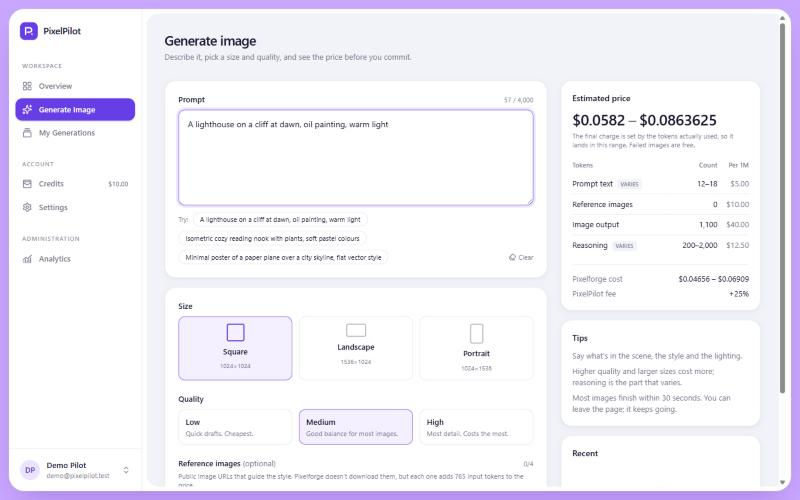
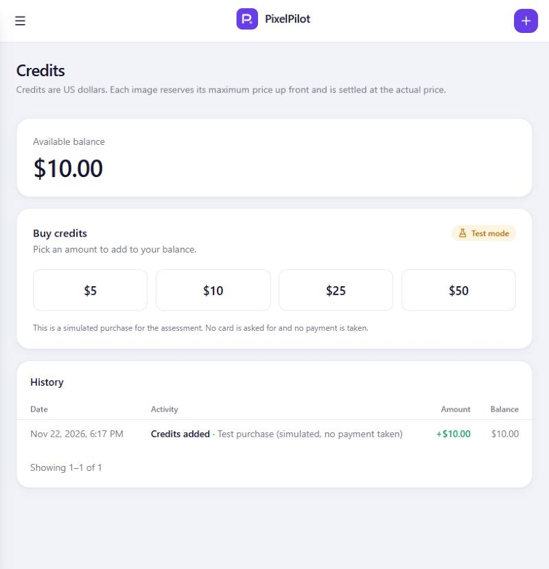

# PixelPilot

**AI Image Studio.** Your prompts. Your vision. One click.

Create, manage and track AI-generated images with transparent pricing. PixelPilot sends image requests to the [Pixelforge](https://pixelforge.promptedit.dev/docs) API, shows users what each image will cost before they submit, records exactly what it did cost (Pixelforge's price plus 25%), and keeps everything in sync through signed webhooks with a polling fallback.

Built for the PromptEdit Senior Product Engineer take-home assessment.

**Live:** https://pixelpilot.boigharbd.com (register to try it; "Buy credits" adds free test credits).



| Sign in | Credits (mobile) |
|---|---|
|  |  |

## Features

- **Generate**: prompt editor with character count and examples, size and quality from Pixelforge's live pricing, up to 4 reference image URLs with previews, and a live price range with a token-by-token breakdown.
- **Exact pricing**: estimates follow Pixelforge's documented token rules. The actual charge is computed from the reported usage at the rates fixed on each generation, with BCMath, stored as `NUMERIC(24,12)`, never rounded. Failed images cost $0. ([docs/pricing.md](docs/pricing.md))
- **History**: search, status filter, sort, pagination, live status, estimated vs actual cost, retry for failures, and a detail page with the full cost breakdown.
- **Webhooks**: HMAC-SHA256 signatures over the raw body, a ±300 s window, events stored once (unique event id), processed on the queue, out-of-order and duplicate safe. ([docs/webhooks.md](docs/webhooks.md))
- **Resilience**: per-generation idempotency keys, capped retries honouring `Retry-After`, queued retries for limits and overloads, a polling fallback with backoff and `SKIP LOCKED` claims, and a sweeper for unprocessed events.
- **Exactly-once money**: one charge row per generation (unique index), CHECK constraints proving cost and markup, and triggers that make final statuses and charges immutable.
- **Overview dashboard**: real per-user totals, success rate, activity, status split, daily spend and recent images.
- **Admin report** *(stretch)*: charges, Pixelforge costs and profit per day and per user, reconciled against `GET /v1/usage` with differences shown.
- **Credits** *(stretch)*: an append-only ledger; reserve the maximum estimate, settle at the actual price, release on failure; simulated "Buy credits".
- **Accounts**: registration, login with throttling, password reset, profile and password settings.

## Tech stack

| | |
|---|---|
| Backend | PHP 8.3+ (tested on 8.5), Laravel 13, PostgreSQL 14+ (tested on 18), Laravel queues and scheduler |
| Frontend | Vue 3 (Composition API, TypeScript), Inertia 3, Tailwind CSS 4, Lucide icons, Chart.js via vue-chartjs |
| Tests | PHPUnit 12 against real PostgreSQL, `Http::fake()` for Pixelforge |
| Tooling | Pint, vue-tsc, Vite 8 |

## Requirements

- PHP 8.3+ with `pdo_pgsql`, `bcmath`, `mbstring`, `intl`
- Composer 2
- Node 20+
- PostgreSQL 14+
- Redis (optional)

## Installation

```bash
git clone https://github.com/ftayebee/pixelpilot.git
cd pixelpilot
composer install
npm install
cp .env.example .env
php artisan key:generate
```

## Environment variables

| Variable | Purpose |
|---|---|
| `APP_URL` | Public URL (used in links and emails) |
| `DB_*` | PostgreSQL connection |
| `QUEUE_CONNECTION`, `CACHE_STORE`, `SESSION_DRIVER` | `database` by default; `redis` if available |
| `PIXELFORGE_BASE_URL` | `https://pixelforge.promptedit.dev/v1` |
| `PIXELFORGE_API_KEY` | API key for **this environment** |
| `PIXELFORGE_WEBHOOK_SECRET` | That key's `whsec_…` signing secret |
| `PIXELFORGE_TIMEOUT` | Request timeout in seconds (default 30) |
| `PIXELPILOT_STORE_IMAGES`, `PIXELPILOT_IMAGE_DISK` | Optionally copy images to a disk (e.g. `s3`) so they outlive Pixelforge's 24 h links |
| `DEMO_USER_PASSWORD` | Local only: password for the seeded demo account |

Secrets only ever live in `.env`, which is git-ignored. Nothing Pixelforge-related is sent to the browser.

## Database setup

```bash
createdb pixelpilot
createdb pixelpilot_test        # used by the test suite
```

Set `DB_DATABASE`, `DB_USERNAME` and `DB_PASSWORD` in `.env`. The connection's session timezone is pinned to UTC.

## Migrations

```bash
php artisan migrate
php artisan db:seed             # local only: demo account demo@pixelpilot.test (admin)
```

The seeder refuses to run outside `local`/`testing`, and prints the demo password (from `DEMO_USER_PASSWORD`, or randomly generated).

## Running locally

```bash
php artisan serve               # http://localhost:8000
npm run dev                     # Vite with hot reload (or: npm run build)
php artisan queue:work          # webhook processing, retries, polling jobs
php artisan schedule:work       # polling fallback, pending-webhook sweeper, usage sync
```

## Queue setup

All background work runs on the default queue: `ProcessPixelforgeEvent`, `SubmitGeneration`, `PollGeneration` and `StoreGenerationImage`. Jobs define their own tries and backoff. In production run at least one `queue:work` process under Supervisor (`deploy/supervisor/pixelpilot-worker.conf`).

## Scheduler setup

| Command | Schedule | What it does |
|---|---|---|
| `pixelforge:poll-generations` | every minute | Checks generations whose webhooks are overdue |
| `pixelforge:process-pending-webhooks` | every 5 min | Re-queues stored events that were never processed |
| `pixelforge:sync-usage --days=7` | hourly | Copies `GET /v1/usage` for reconciliation |

Cron: `* * * * * cd /path/to/pixelpilot && php artisan schedule:run >> /dev/null 2>&1`

## Pixelforge API setup

1. Create an account at <https://pixelforge.promptedit.dev>.
2. Create **one API key per environment** (e.g. `local`, `production`). Each key has its own webhook URL, signing secret and usage report.
3. Put the key and its signing secret in that environment's `.env`.

The integration contract PixelPilot relies on is summarised in [docs/pixelforge-api.md](docs/pixelforge-api.md).

## Webhook configuration

Set the key's webhook URL in the Pixelforge dashboard to:

```
https://YOUR-DOMAIN/webhooks/pixelforge
```

The endpoint sits outside the `web` middleware group (no CSRF/session) and rejects anything not signed with `PIXELFORGE_WEBHOOK_SECRET`. Use **Send test event** in the dashboard to check it: expect `204`.

## Local tunnel

Pixelforge won't deliver to `localhost`, so expose your dev server:

```bash
cloudflared tunnel --url http://localhost:8000
# or: ngrok http 8000  /  expose share http://localhost:8000
```

Then use `https://<tunnel-host>/webhooks/pixelforge` as the **local** key's webhook URL. Without a tunnel everything still works: the polling fallback picks up results within about a minute.

## Tests

```bash
php artisan test                # 194 tests, ~20 s, needs the pixelpilot_test database
vendor/bin/pint --test          # code style
npm run typecheck               # Vue / TypeScript
php artisan pixelforge:smoke you@example.com   # live run of Pixelforge's test keywords (needs a key and credits)
```

What's covered and how each assessment scenario is tested: [docs/test-report.md](docs/test-report.md).

## Production deployment

Step-by-step VPS/Forge instructions, a production `.env`, Nginx and Supervisor configs, cron and a deploy script are in [docs/deployment.md](docs/deployment.md) and [`deploy/`](deploy/). In short: PHP-FPM + Nginx with HTTPS, PostgreSQL, a Supervisor-managed `queue:work`, the scheduler cron, `php artisan migrate --force` on deploy, and a **separate** Pixelforge key for production.

The live instance runs the Docker stack instead (`docker/`, `docker-compose.prod.yml`, `deploy/docker/`): PHP-FPM, Nginx, a queue worker, the scheduler and PostgreSQL in containers, behind the server's existing Traefik for HTTPS. See [Docker on a server with Traefik](docs/deployment.md#docker-on-a-server-with-traefik).

## Admin user

No admin exists by default and production is never seeded. Register, then:

```bash
php artisan pixelpilot:make-admin you@example.com            # grant
php artisan pixelpilot:make-admin you@example.com --revoke   # revoke
```

Admins see **Administration → Analytics** (`/admin/analytics`).

## Project docs

| | |
|---|---|
| [docs/architecture.md](docs/architecture.md) | Code map, data model, lifecycle, decisions, assumptions |
| [docs/pixelforge-api.md](docs/pixelforge-api.md) | The Pixelforge contract we depend on |
| [docs/pricing.md](docs/pricing.md) | Estimates, actual charges, precision policy, credits |
| [docs/webhooks.md](docs/webhooks.md) | Signature verification and reliable processing |
| [docs/deployment.md](docs/deployment.md) | Production setup and operations |
| [docs/test-report.md](docs/test-report.md) | What's tested and verified |
| [docs/development-progress.md](docs/development-progress.md) | Milestone log |

## Known limitations

- **Images expire** 24 hours after completion unless `PIXELPILOT_STORE_IMAGES` is enabled; after that the UI shows a placeholder instead of a broken image.
- **Credits are simulated**: there's no payment provider. "Buy credits" is clearly marked as a test purchase.
- **Status updates in the browser** use short-interval Inertia polling of our own database, not WebSockets.
- **Reconciliation is per day and per key**, matching how `/v1/usage` reports. Per-generation differences have to be traced from the day they appear on.
- **Content-policy rejections** count as failed generations in a user's success rate.
- **Single currency** (USD), as Pixelforge bills only in USD.
